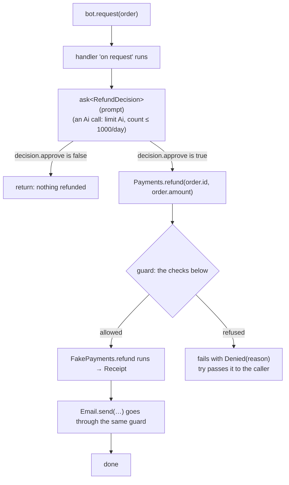

# 05: A refund agent with guardrails

This example is an **agent**: a program that handles events (here, refund requests), asks an AI model for a decision, and acts on outside systems (payments, email). Kavach's promise for agents is that the code says **what the agent may do, how much, and when a person must decide**, and the compiler and runtime make sure it can't do anything else.

| File | What it is |
|---|---|
| [src/main.kav](src/main.kav) | The agent, its capabilities, simple implementations, and `main` |
| [kavach.toml](kavach.toml) | The package; the agent's mode and audit log are its `settings` in the code |

The rules are in [spec chapter 8](../../docs/spec/08-capabilities-and-agents/README.md). This page explains them with this example.

> **Status (2026-11-01):** the interpreter runs agents: `can` and `start` are checked at compile time; capability calls go to the agent's implementations through its limits and approvals; `ask<T>` calls the model; modes and the audit log come from the agent's `settings`; `kavach run --dry-run` answers every call with a generated value. Still to come: durable approvals (today a person answers at the terminal, and with no terminal the call is refused), limit totals that survive a restart, and native code.

## The parts

```kavach
agent RefundBot {
    can Ai, Payments.refund, Email.send          // what it may touch

    limit Payments.refund {                       // hard boundaries
        amount <= 10_000
        sum(amount) <= 50_000 per day
        count <= 100 per day
    }

    approve Payments.refund when amount > 5_000 by "finance"   // a person decides

    on request(order: Order) ! Error { … }        // an event it handles
}
```

| Part | Meaning | Checked |
|---|---|---|
| `capability Payments { … }` | An outside system the code depends on, described as functions. Code calls `Payments.refund(…)` without knowing who implements it. | – |
| `can` | The capabilities (whole, `Email`, or one method, `Payments.refund`) the agent's handlers may use, directly or through any function they call. | **Compile time**: anything else is an error. |
| `limit` | Rules on one capability method. Inside the block, the method's arguments (`amount`, `order_id`) are names. | **Each call**, at run time |
| `approve … when … by …` | When the condition is true for a call, a person in the named role must approve it first. | **Each call**, at run time |
| `on name(params)` | An event the agent handles. It becomes a method on the running agent: `bot.request(order)`. | – |
| `model decisions()` | The AI model, and its settings, every `ask` in the handlers uses: a `Model` value, here from a function so several agents could share it (spec 8.4). | **Compile time**: the model is worked out when the program is built |
| `ask<T>(prompt)` | Asks the AI model and gets back a checked value of type `T`, not text. Needs `Ai` in `can`. | The answer is validated against `T` |

## Starting the agent

```kavach
const bot = RefundBot.start(
    Payments: FakePayments(),    // who answers Payments calls
    Email: ConsoleEmail(),       // who answers Email calls
)
try bot.request(order)           // handle one event
```

`start` needs exactly one implementation for each capability the agent `can` use (built-in ones like `Ai` need none). A missing one, or a type that doesn't implement the capability, is a compile error. Swapping `FakePayments()` for a real Stripe client changes nothing else in the code.

## The flow of one event



Every capability call, including the AI call, goes through the **same guard**. Nothing in the handler needs to remember to check or log anything.

## The checks on every capability call

In this order ([spec 8.3](../../docs/spec/08-capabilities-and-agents/03-agents.md#the-order-of-the-checks)):

| Step | Question | If no |
|---|---|---|
| 1. `can` | May this agent make this call at all? | The program doesn't compile |
| 2. `--dry-run` | Is this a dry run? | (If yes: the call is checked and logged, but not executed; it gets a simulated result) |
| 3. Limits | Does the call keep every `limit` rule, counting this call in its window's totals? | Refused: `Denied("amount <= 10_000")` |
| 4. Approval | Does an `approve` condition hold? Then: does the person approve? | Refused if rejected or timed out: `Denied(…)` |
| 5. The call | Runs on the implementation given to `start` | (Its own errors, such as `Declined`) |

Limits come before the approval, so the finance team is never asked about a refund that would be refused anyway. Only calls that actually run count toward `sum(amount)` and `count`.

### What happens to different orders

With the rules above, in `enforce` mode:

| Order | Step 3, limits | Step 4, approval | Result |
|---|---|---|---|
| 1,499 | ok | not needed (1,499 is not over 5,000) | refunded at once |
| 7,499 | ok | needed: the handler **pauses** until someone in `finance` decides | refunded if approved; `Denied` if rejected |
| 12,000 | `amount <= 10_000` is broken | – | `Denied`: never executed, no one asked |
| any, after 50,000 refunded today | `sum(amount) <= 50,000 per day` would be broken | – | `Denied` until the next day |
| the 101st today | `count <= 100 per day` is broken | – | `Denied` until the next day |

A refused call fails with the error `Denied(reason)`. Every capability method's error type declares that variant (`type PaymentError = Declined | Unavailable | Denied(reason: String)`), and the compiler checks it, so code handles a refusal like any other error. Here `try` passes it on, so `bot.request(order)` fails with it.

## Modes: earning trust step by step

The mode is set per agent in its `settings`, next to its rules ([decision 0060](../../docs/decisions/0060-agent-settings-are-chosen-in-code.md)):

```kavach
settings AgentSettings(mode: AgentMode.Observe, audit: Audit(file: "audit/refund-bot.log"))
```


| Mode | Calls | Limits and approvals |
|---|---|---|
| `observe` | Run normally | Evaluated and **only reported** in the audit log ("would have blocked 3 refunds") |
| `suggest` | Every call waits for a person | Shown with each request |
| `enforce` | Run when allowed | **Enforced**: refused calls fail, approvals pause |

This example starts in `observe`: a company can watch what the agent *would* block before letting it act on its own. `kavach run --dry-run` goes further: no capability call runs at all, so it is safe to try anywhere.

## The audit log

The runtime writes every capability call to the file the agent's `Audit` names (`audit/refund-bot.log`), whatever the mode:

```
2026-11-02T10:14:07Z RefundBot request#8812 Payments.refund(order_id: 1042, amount: 7499.00)
  verdict: approval required (amount > 5_000) → approved by finance:meera at 10:31:55Z
  result: ok Receipt(id: "re_3Kx…")
```

It is append-only, and the handler can't skip it.

## Secrets

`Order.card_last4` is marked `secret`. The compiler tracks where its value goes: it may not reach `print`, a log, the audit log (shown as `<secret>`), an error message, or an AI prompt. Writing `{order.card_last4}` in the `ask` prompt is a **compile error**, so the card number can never be sent to the AI model.

## Try it

```
kavach check examples/05-refund-bot/src/main.kav            # the compile-time checks
kavach run --dry-run examples/05-refund-bot/src/main.kav    # nothing runs, no key needed, nothing costs
kavach run examples/05-refund-bot/src/main.kav              # needs ANTHROPIC_API_KEY for the AI call
```

Without a key, `ask` fails with `AiError.NoKey`. To try it without any cost, point `KAVACH_AI_URL` at a local server that answers like the model (the tests in [tools/cli/tests/ai.rs](../../tools/cli/tests/ai.rs) do).
